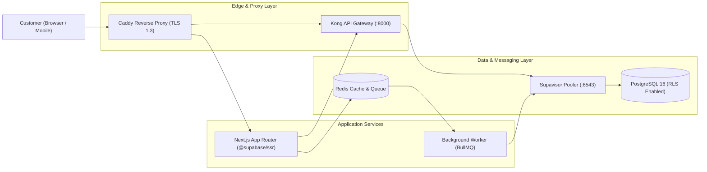

# ADR Template & Mermaid Architecture Diagram Recipes Reference

## 1. UKG-Compliant ADR Template (`docs/decisions/adr-001-supabase-rls.md`)
```markdown
---
id: adr-001-supabase-rls
title: "ADR-001: Enforce Tenant Isolation via PostgreSQL Row Level Security (RLS)"
type: "ADR"
status: "accepted"
owner: "@architecture-team"
depends_on:
  - "[[auth-service]]"
  - "[[postgres-orders-schema]]"
tags: [adr, security, supabase, postgres, rls]
last_updated: 2026-10-31
---

# ADR-001: Enforce Tenant Isolation via PostgreSQL Row Level Security (RLS)

## 1. Context & Problem Statement
Our multi-tenant SaaS platform serves multiple organizations from shared PostgreSQL tables. Application-layer `WHERE organization_id = ?` filters alone risk accidental cross-tenant data leaks (BOLA/IDOR) if a developer forgets a predicate in a new query.

## 2. Considered Options
1. **Application-layer filtering only** (via ORM middleware/repositories).
2. **PostgreSQL Row Level Security (RLS)** enforced on all `public` schema tables using JWT claims (`(select auth.uid())`).
3. **Separate PostgreSQL schema/database per tenant**.

## 3. Decision Outcome
Chosen option: **Option 2 (PostgreSQL RLS + Application DTO validation)**, because it provides defense-in-depth at the database engine level without the operational migration overhead of hundreds of isolated tenant schemas.

## 4. Consequences
- **Positive**: Client and SSR queries using publishable keys (`sb_publishable_...`) cannot read or mutate rows outside their authorized tenant even if a query omits a filter.
- **Negative / Mitigations**: RLS policy expressions must wrap `auth.uid()` in `(select auth.uid())` and every policy column must have a B-tree index to prevent sequential scan bottlenecks. Governed components: [[orders-service]], [[postgres-orders-schema]].
```

---

## 2. C4 Container Diagram in Mermaid (`flowchart LR`)


---

## 3. Async Webhook & Outbox Sequence Diagram (`sequenceDiagram`)
```mermaid
sequenceDiagram
  autonumber
  participant Stripe as Stripe Webhook
  participant API as Orders API
  participant DB as PostgreSQL (Orders + Outbox)
  participant Worker as Outbox Relay Worker

  Stripe->>API: POST /webhooks/stripe (Stripe-Signature)
  API->>API: Verify HMAC-SHA256 & timestamp (< 5m)
  alt Invalid Signature or Replay
    API-->>Stripe: 400 Bad Request
  else Valid Signature
    API->>DB: BEGIN; UPDATE orders + INSERT outbox_events (Idempotent)
    DB-->>API: COMMIT
    API-->>Stripe: 202 Accepted
    Worker->>DB: SELECT ... FROM outbox_events FOR UPDATE SKIP LOCKED
    Worker->>Worker: Dispatch fulfillment & mark processed
  end
```
